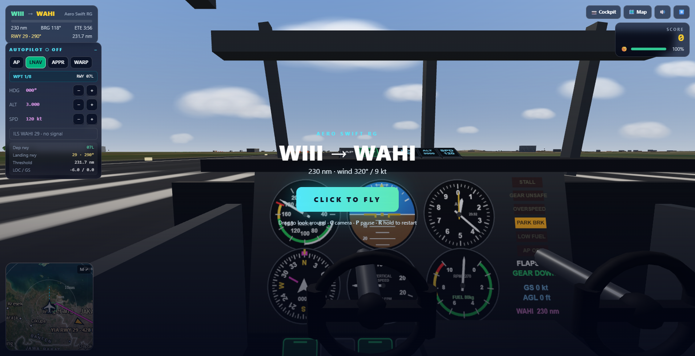
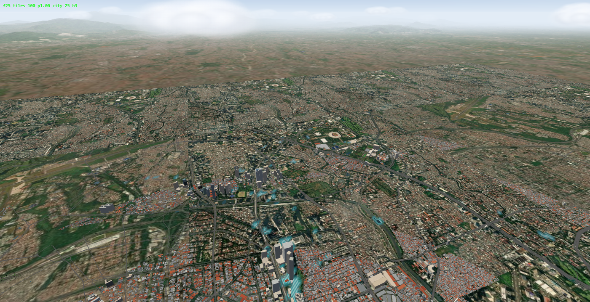
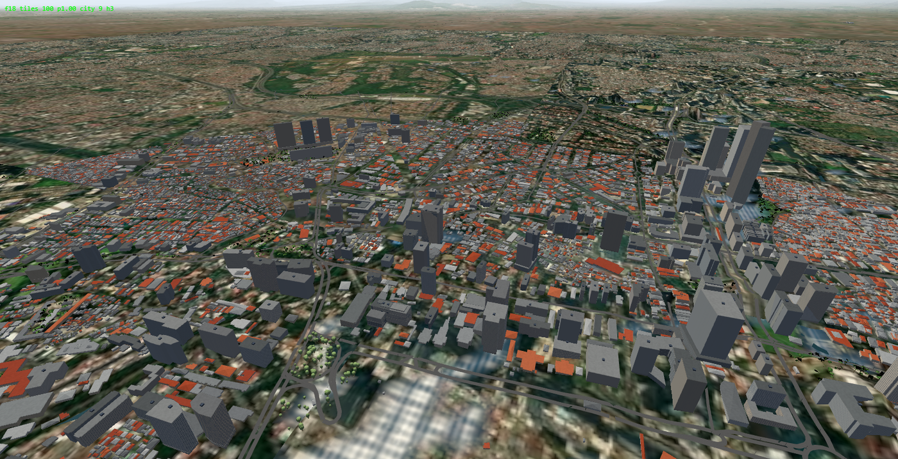
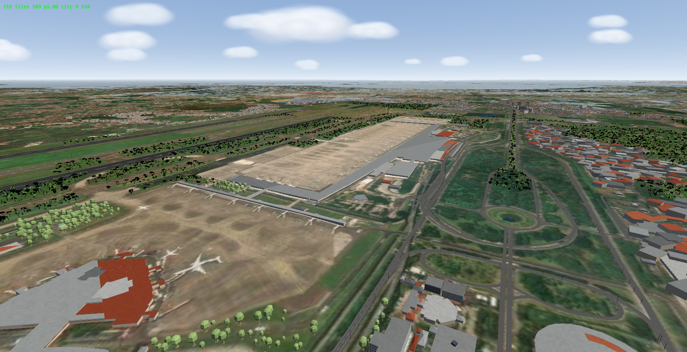

# In-Flight ✈️

> A photorealistic, high-performance web flight simulator built with **Three.js**, **React 19**, and **TypeScript**, powered by worldwide OpenStreetMap data and real-time terrain streaming.



---

## 🌟 Features

### 🌍 Worldwide Terrain & Dynamic Tile Streaming
- **Streamed Real-World Geospatial Data**: Procedural streaming of terrain heightmaps, satellite/vector land cover, roads, and coastlines using OpenStreetMap and Mapbox Vector Tiles (MVT).
- **8,400+ Global Airports**: Database of real-world airports (`src/data/airports.ts`) with accurate runway orientations, dimensions, ICAO identifiers, and field elevations.
- **Procedural Scenery & Urban Environments**: High-density 3D building generation, road networks, runway lighting, PAPI lights, and instanced 3D tree vegetation.

### 🛩️ Rigid-Body Aerodynamic Physics
- **Realistic Flight Dynamics**:
  - Lift curve slopes ($C_L$), drag polars ($C_{D0}$ + induced drag), and dynamic stalls.
  - Flap extension aerodynamics ($C_{L,\text{flap}}$, $C_{D,\text{flap}}$) and landing gear parasite drag.
  - Trim elevator adjustments, ground effect lift cushioning, and crosswind weathercocking.
- **Ground Handling & Suspension**:
  - Multi-point oleo strut spring-damper suspension physics.
  - Ground friction, differential braking, and steerable nose/tail wheels.
  - Reverse thrust and spoiler aerodynamic speedbrakes.

### 🧭 Full Avionics & Autopilot System
- **Autopilot Modes**:
  - **HDG** (Heading Select & Hold)
  - **ALT** (Barometric Altitude Hold)
  - **VS** (Vertical Speed Select)
  - **NAV** (LNAV Waypoint Tracking with Great-Circle navigation)
  - **APPR** (ILS Approach mode with Localizer and 3° Glideslope intercept)
- **Air Traffic Control (ATC)**:
  - Interactive ATC dialog system with frequency handoffs, runway clearances, altitude assignments, and vectoring.
- **Glass & Analog Instrumentation**:
  - Primary Flight Display (PFD) with artificial horizon, flight director, airspeed tape, altimeter tape, vertical speed indicator, and compass rose.
  - Top-down tactical navigation moving map (`CanvasMap`) with airspace boundaries, ILS feathers, and flight plan waypoints.

### 🧭 In-flight navigation workspace

The flight starts with a clear view, a compact **MSFS-style icon toolbar**, and next-waypoint information beside the route. A small live navigation map is visible by default. External standard view uses a heading compass and edge-mounted round gauges, leaving the aircraft and horizon clear. The toolbar stays visible by default; its **pin** button enables MSFS-style auto-hide when desired.

- **Navigation** — one window with **Map** and **Flight plan** tabs, rather than competing map/route panels. Click the route at the top left to open the flight plan directly. Selecting a waypoint shows it on the map without changing the active leg. Map position/orientation and flight-log scroll position survive tab switches.
- **Map (`M`)** — expands the small circular moving-map/compass at the left of the flight view to fill the entire screen, hiding the toolbar, instruments, touch controls, notifications and tool windows. Press `M` or `Esc` to return to the same flight workspace. Clicking the small map does the same. Map view/zoom/orientation are shared across the small chart, Navigation window and full-screen chart. Dragging releases follow; the target button restores aircraft-follow. Style, layers and arrival runway remain available under the collapsed **Map options** control. `Shift+M` remains an alias.
- **Autopilot** — plain-language **Route / Heading / Approach** choices retain NAV / HDG / APPR annotations. Managed altitude/speed are clearly read-only. The arrival-runway dropdown lists the actual available runways instead of cycling blindly through them.
- **Radio** — the current call and all four responses are together; older transmissions are behind **Transmission history**. Number keys `1`–`4` send replies only while this window is expanded; otherwise they remain throttle presets. One exchange is active at a time (shown as **Transmitting**); replies follow simulation time, pause with the flight, and cannot leak into a restarted flight.
- **Camera** — Cockpit and External are the primary choices. Cabin, Window and Spotter are under **More camera views**. Choosing a view returns straight to flying.
- **Display** — the four layouts **Standard / Minimal / Assisted / Cockpit** are available with `H` and in Display. Standard restores the external round gauges; Minimal keeps essential telemetry; Assisted adds glass instruments and guidance; Cockpit uses the working 3D instruments. Text size, units, accessibility and shortcut references use expandable sections. Changing HUD mode never opens, closes or switches a tool.

Only **one task window** is open at a time, in a predictable location. Its title bar can minimize or close it; click the minimized title or its toolbar button to restore it in one action. **Return to flight** or `Esc` closes the window and restores aircraft keyboard input—not toolbar navigation. In full-screen map mode, `M` and `Esc` return without changing the previously open tool. An active target edit owns the first `Esc`; `Esc` pauses only when no tool is open.

Panel geometry stays compact at every text-size setting. On short screens, navigation tabs merge into the title bar; touch layouts keep both thumb-control zones clear. The four HUD modes remain available with `H` and the controller HUD button. Cockpit views avoid duplicating the aircraft’s instruments. High contrast, reduced motion and keyboard tab/arrow navigation are supported.

The chart reads aircraft position, heading and ground track directly from the flight model on animation frames, while caching geographic artwork instead of rebuilding it every frame. Full-screen mode skips hidden 3D rendering but continues physics, terrain streaming and audio. Map/ILS runway geometry uses the airport database; invented taxiway/apron diagrams are not shown. Wind readouts use the aircraft's actual local wind/gust vector, and the flight director uses the existing autopilot command rather than a fixed climb angle. Missing external imagery does not disable the live aircraft, route, airports or georeferenced grid; failed providers use bounded retry backoff.

Speech is serialized and deduplicated, stale callouts are dropped, and pause/mute/voice-off/restart clear pending playback. Genuine active safety warnings may still repeat after their cooldown; resolved warnings do not continue playing from a backlog. Flight-phase hysteresis prevents repeated clearance chimes during go-around and speed-threshold jitter. The aerodynamic flight model is unchanged.

### 🕒 1:1 real-time simulation

- **One clock**: the simulator runs on the real-world UTC clock (`src/sim/clock.ts`). Sun position (NOAA / Meeus solar algorithm, cross-checked against the sunrise-sunset.org API in `scripts/clock-test.ts`), sky colour, stars, night lighting and city lights follow the real time at the aircraft's actual position, continuously through dawn, day, dusk and night. The planner shows the live UTC time and the real light condition at the departure airfield; the flight HUD shows UTC (`Z`) and the ETA in UTC.
- **No time compression / manual time-of-day**: simulation rate is locked at 1× so in-game time can never diverge from real time (the old `Day / Sunset` presets and the 2×–8× warp were removed).

### 🛬 Runway data & selected-runway focus

- **Runway marker follows the chosen runway**: zoomed out, the DEP / ARR marker sits on the airport; as the map zooms in it slides onto the *selected runway threshold* (physical end for take-off, displaced threshold for landing), the runway is highlighted with a direction chevron, and choosing a runway re-centres/zooms the map on that runway rather than on the airport centre.
- **Runway database rebuilt** (`scripts/build-world-runways.mjs`, sources: OurAirports + OpenStreetMap): all runways are kept (the old build capped at 3 per airport – ORD now has 8, DEN 6), airports were widened to every large/medium airport and scheduled/IATA small airport, wrong threshold coordinates are rejected by heading/position sanity checks, and headings for unmapped runways use the World Magnetic Model to convert magnetic runway numbers to true bearings.
- **Live survey upgrade** (`src/data/runwayRefine.ts`): any airport whose runways are still approximate is upgraded in place from OpenStreetMap (Overpass) when selected or before a flight loads, cached in `localStorage`, silently falling back to bundled data when offline.

### 🔊 Procedural Web Audio & GPWS
- Real-time synthesized engine sounds: piston rumble, turboprop whine, and twin-spool turbofan jet roar.
- Aerodynamic wind rush scaling with airspeed ($V^2$) and flap/gear extension.
- Wheel touchdown tire screech and airframe roll rumbling.
- **Ground Proximity Warning System (GPWS)**:
  - Callouts: *"Sink Rate"*, *"Terrain, Pull Up"*, *"Glideslope"*, *"500"*, *"Minimums"*.
  - Stall warning horn and overspeed clacker.

## 🆕 Real-scale airside, hangar departures, airport map & automatic voiced ATC

**Real-world scale (verified online).** Aircraft are 1:1 (C172S 8.28 m × 11.0 m, ATR 72-600 27.17 m × 27.05 m, A320-200 37.57 m × 34.10 m). Pilot eye height above ground is now ≈ 1.7 m (C172), 3.3 m (ATR), 4.8 m (A320; eye-to-wheel ≈ 20 ft in the flare). The world camera's near plane is 0.6 m on the ground (it was 1.8 m), so nothing in front of / below the pilot is clipped. Airside layout follows ICAO Annex 14 Vol. I: runway→parallel-taxiway centre-line separation 168 m (code 3/4 instrument, code C), 87–120 m for shorter runways, 4.5 m stand clearance (Table 3-1, 3.12.6), runway-holding position 40–90 m from the centre line.

**Hangar departures (`src/sim/airportGround.ts`).** The aircraft starts cold & dark *outside the doors of a designated hangar*, nose towards the taxiway, never inside a building, on a runway, or at a boarding bridge with the fuselage in a terminal wall:
- surveyed airfields (OSM layout, 330 Indonesian fields): the smallest suitable hangar (≥ 80 m² for a C172, ≥ 700 m² ATR, ≥ 1 400 m² A320) is chosen; the parking spot is computed from the hangar's oriented bounding box, every candidate face is validated against all hangar/terminal footprints (4.5 m ICAO clearance), runway corridors and taxiway surfaces. Explicit gates/stands are pulled back so the nose-wheel mark – not the CG – sits at the stand line.
- all other airports: a deterministic, shared synthetic airside (ICAO taxiway separation, hangar apron, maintenance hangar for ATR/A320, T-hangars for light aircraft; small fields get a small terminal instead of jet bridges) that is placed clear of every other runway. The 3D scenery and the spawn use the same plan, so they always agree.
- Trees, procedural houses and mapped OSM buildings are excluded from taxiways, aprons, hangars, terminals, stands and from the parked aircraft's footprint; the terrain plate is levelled under aprons/hangars so the aircraft never floats or sinks.
- `npx tsx scripts/spawn-test.ts` checks ~16 000 spawns (all airports with a survey + sample): 0 overlaps with buildings, 5 pathological multi-runway airports reported.

**Airport / runway navigation display (top-left).** `AirportMiniMap` is independent of the full-screen map (`M`): own range, orientation (heading-up / north-up) and zoom (+ / − / A=auto). Shows runways at true width with idents (departure runway green, arrival runway cyan), taxiways, aprons, hangars, terminals, stands, hold-short points, the **taxi route** (names of taxiways) to the departure runway, the final-approach course with 5/10 NM marks, the active waypoint, the aircraft at its real wingspan × length, scale bar and north arrow. Auto range: airport diagram (0.8–2.6 km) on the ground, approach scale (3–12 km) in the air; the square display is 256 px (was a 176 px circle).

**Automatic, voiced ATC (`src/sim/atc.ts`).** No manual input. Every instruction is a complete standard exchange – *pilot call → controller → pilot readback → "readback correct"* (IFR clearance) – for clearance delivery, pushback / start-up, taxi, line up and wait, take-off clearance, hand-off, descent, landing clearance (with "request landing clearance"), vacating and ground. Mandatory readbacks follow ICAO Annex 10 / Doc 4444 / Doc 9432 and FAA JO 7110.65 / AIM (clearances, runway entry/take-off/landing/hold short, runway in use, QNH, SSR code, levels). Speech uses ICAO number pronunciation (*zero, tree, fower, fife, niner*, "decimal", flight levels ≥ 18 000 ft), distinct controller / pilot voices, and a squelch click on every key-up. Subtitles show the speaker live; the **Radio** window keeps the full transmission history. Pause stops the speech; restarting a flight clears the queue. `npx tsx scripts/atc-test.ts` prints sample exchanges.

---

## ✈️ Aircraft Roster

| Aircraft | Type | Engines | Cruise Speed | Ceiling | Features |
|---|---|:---:|:---:|:---:|---|
| **Aero Swift RG** | Light Single | 1x Piston (165 kW) | 125 kt | 18,000 ft | Retractable gear, forgiving flight envelope, analog 6-pack instruments. Perfect for VFR training. |
| **Aero Trek T2** | Commuter STOL | 2x Turboprop (1,300 kW) | 190 kt | 28,000 ft | High-lift slotted flaps, beta reverse thrust, rugged short-field performance. |
| **Skyliner 320** | Narrow-body Jet | 2x Turbofan (225 kN) | 450 kt | 39,000 ft | Glass cockpit, flight management system, speedbrakes, reverse thrust, CAT-III ILS autoland. |

---

## 🎮 Flight Controls

### Keyboard & Mouse

| Action | Primary Key | Secondary / Description |
|---|---|---|
| **Elevator (Pitch)** | `W` / `S` | `ArrowUp` (Push down) / `ArrowDown` (Pull up) |
| **Aileron (Roll)** | `A` / `D` | `ArrowLeft` / `ArrowRight` |
| **Rudder (Yaw / Steer)** | `Q` / `E` | Nosewheel steering on ground |
| **Throttle Increase / Decrease** | `Shift` / `Ctrl` | `PageUp` / `PageDown` (Hold to adjust) |
| **Throttle Presets** | `1` - `9`, `0` | `1` = 10%, `5` = 50%, `0` = 100%, `X` = Cut to Idle |
| **Wheel Brakes** | `Space` | Progressive pneumatic / hydraulic braking |
| **Parking Brake** | `B` | Toggle parking brake |
| **Landing Gear** | `G` | Toggle gear extension (inhibited on ground) |
| **Flaps Extend / Retract** | `F` / `V` | Cycle flap detents |
| **Speedbrake / Spoilers** | `Z` | Deploy / retract aerodynamic spoilers (Jet only) |
| **Reverse Thrust** | `T` | Toggle thrust reversers (Turboprop & Jet) |
| **Elevator Trim** | `Insert` / `Delete` | Trim pitch up / down |
| **Camera View** | `C` | Cycle Cockpit / Chase / Spotter / Cabin |
| **Look Around** | `Right Click + Drag` | Pan camera (`Home` to reset view) |
| **Autopilot Master** | `Y` | Engage / Disengage Autopilot |
| **Autopilot NAV Mode** | `N` | Toggle LNAV waypoint tracking |
| **Autopilot APPR Mode** | `U` | Arm / Engage ILS Approach |
| **Heading Bug Adjust** | `,` / `.` | Heading decrements / increments |
| **Altitude Target Adjust** | `[` / `]` | `Shift + [` / `]` for 1000 ft steps |
| **Speed Target Adjust** | `-` / `=` | Target airspeed adjust |
| **Navigation Map** | `M` | Full-screen map with other UI hidden; `M` or `Esc` returns to flight |
| **HUD Mode** | `H` | Cycle Standard / Minimal / Assisted / Cockpit HUD layouts |
| **Time Warp** | `\` | Disabled – simulation is locked to 1:1 real time |
| **ATC Response** | `1`, `2`, `3`, `4` | Respond while the Radio panel is open; otherwise throttle presets |
| **Pause / Resume** | `Esc` or `P` | Pause simulation |
| **Restart Flight** | `R` (Hold) | Reset flight to runway |

### Gamepad Support (Xbox / PlayStation / Generic)
- **Left Stick**: Pitch and Roll
- **Right Stick / Triggers**: Rudder / Yaw, Left Trigger / Right Trigger for Throttle
- **A / Cross**: Toggle Landing Gear
- **B / Circle**: Parking Brake
- **LB / RB**: Flaps Down / Flaps Up
- **Y / Triangle**: Autopilot Toggle
- **D-Pad**: ATC Quick Responses (Up: 1, Down: 2, Left: 3, Right: 4)

---

## 📸 Screenshots

| High-Altitude Cruise | Cockpit & Avionics |
|:---:|:---:|
|  |  |

| Urban Scenery & Water Shaders | Aerodrome Approach |
|:---:|:---:|
|  |  |

---

## 🛠️ Technology Stack

- **Graphics Core**: [Three.js](https://threejs.org/) (Custom shaders, PBR materials, instanced meshes, shadow cascades)
- **Frontend Framework**: [React 19](https://react.dev/) + [TypeScript 5.9](https://www.typescriptlang.org/)
- **Styling**: [Tailwind CSS v4](https://tailwindcss.com/)
- **Bundler & Tooling**: [Vite 7](https://vitejs.dev/) with Singlefile bundling support
- **Spatial Math & Geodesy**: WGS84 coordinates, Vincenty / Haversine great-circle navigation, Web Mercator projection

---

## 🚀 Getting Started

### Prerequisites
- Node.js (v18.0.0 or higher recommended)
- npm or pnpm / yarn

### Installation
```bash
git clone https://github.com/sansaks-jpg/in-flight.git
cd in-flight
npm install
```

### Development Server
```bash
npm run dev
```
Open your browser and navigate to `http://localhost:5173` (or the port indicated in your console).

### Production Build
```bash
npm run build
```
The optimized bundle will be created inside the `dist/` directory.

---

## ✅ Verification

```bash
npm test                 # Navigation, speech queue, tile backoff and phase/telemetry regressions
npm run build            # Strict TypeScript check + single-file production build
```

For browser interaction and layout regression checks:

```bash
npx playwright install chromium
npm run dev              # Leave running in one terminal
npm run test:ui           # Layout, keyboard and touch interactions in another terminal
npm run test:live         # Unfrozen physics/map tracking, data and radio lifecycle checks
```

The browser suite exercises real map, autopilot, radio and keyboard interactions, then measures actual DOM geometry across **672 combinations** of viewport, UI scale, HUD mode, alerts and open tools on desktop and touch devices. It also checks expanded-map space and clipped map controls, with third-party scenery requests disabled to verify offline navigation. The separate live suite samples the actual drawn aircraft transform against the running flight model, checks chart-cache reprojection, validates live navigation values and selected runway endpoints, and exercises radio pause/restart safety. Failures save a screenshot under the ignored `.tmp/` directory. Set `FLIGHT_UI_URL` to test another dev-server URL, or `CHROMIUM_PATH` to use an existing Chromium executable.

---

## 📂 Project Structure

```text
in-flight/
├── public/                 # Static assets
├── screenshots/            # Showcase images
├── scripts/                # Airport builders, asset compression, unit test scripts
│   ├── build-airports.mjs  # Airport database generator
│   ├── compress-tree.mjs   # glTF/GLB geometry optimizer
│   └── phys-test.ts        # Physics verification routines
├── src/
│   ├── assets/             # 3D models and textures (GLB, shaders)
│   ├── data/               # 8,400+ Airport database and runway threshold specifications
│   ├── sim/                # Core simulation engine
│   │   ├── aircraftModel.ts# 3D aircraft visual representation & control surface articulation
│   │   ├── audio.ts        # Procedural Web Audio engine & GPWS synthesizer
│   │   ├── autopilot.ts    # PID controllers, flight director, ILS guidance
│   │   ├── cockpit.ts      # 3D cockpit interior, dials, levers, PFD/MFD screens
│   │   ├── game.ts         # Main game loop, state machine, ATC dispatcher
│   │   ├── geo.ts          # Geodetic calculations, coordinate transformations
│   │   ├── instruments.ts  # HUD instrumentation, tape gauges, compass
│   │   ├── mvt.ts          # Mapbox vector tile parser & terrain geometry
│   │   ├── physics.ts      # Flight physics, aerodynamic coefficients, gear dynamics
│   │   ├── quality.ts      # Performance presets (Ultra, High, Medium, Low, Mobile)
│   │   ├── specs.ts        # Aircraft configuration & aerodynamic parameters
│   │   ├── structures.ts   # Procedural buildings, runway markings, approach lighting
│   │   ├── terrain.ts      # Elevation sampling & terrain mesh management
│   │   └── world.ts        # Atmosphere, skybox, sun/moon, volumetric fog & clouds
│   ├── ui/                 # React UI layer
│   │   ├── CanvasMap.ts    # Tactical 2D moving map
│   │   ├── Hud.tsx         # Flight screens and HUD exports
│   │   ├── FlightHud.tsx   # In-flight toolbar, tool workspace and contextual telemetry
│   │   ├── FlightMap.tsx   # Navigation panel and expanded live map
│   │   ├── FlightInstruments.tsx # PFD instruments and touch flight controls
│   │   ├── MapPanel.tsx    # Interactive flight planner map
│   │   ├── Planner.tsx     # Route planning & runway departure/arrival selector
│   │   └── Screens.tsx     # Main menu, aircraft selection, settings
│   ├── App.tsx             # Main application orchestrator
│   └── main.tsx            # React DOM entry point
├── package.json
├── tsconfig.json
└── vite.config.ts
```

---

## 📄 License

This project is licensed under the MIT License.
Third-party 3D model assets are licensed under their respective authors (see `src/assets/LICENSE-kenney-nature.txt`).


---

## A320 flight deck (3D cockpit)

- **Aircraft**: Airbus A320-200 only. Interactive 3D flight deck (FlightGear A320-family model, GPL-2.0) with about 570 operable controls wired to the electrical, APU, bleed/pack, hydraulic, fuel, engine-start, autoflight and flight-control simulation.
- **Live displays**: PFD, ND, E/WD, SD (all pages), MCDU x2, ISIS, FCU digits and clock, driven by real-time telemetry.
- **EFB tablet** (captain's window mount): flight plan, checklists, airport/runway data, radio frequencies, live METAR weather with runway wind components, and basic procedures. Click the tabs, tick checklist items, scroll with the wheel.
- **Camera (MSFS-style)**: drag to look, Shift/middle-drag to lean, wheel to zoom, double-click a control to fly to it, double-click empty space to return; the camera panel offers PFD / ND / ECAM / FCU / overhead / pedestal / MCDU / EFB views.
- **Tooltips**: hover any control for its real-world name, function and current state.
- Model asset: `public/models/a320/cockpit.glb` (compressed, ships with the project) with pinned runtime fallbacks; see `public/models/a320/NOTICE.txt`.
